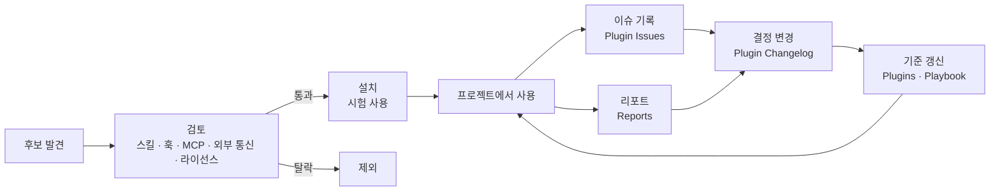

# side-toolkit

> 1인 개발자가 Claude Code로 사이드 프로젝트를 만들면서 쓰는 **플러그인 관리 기록**입니다.
> 어떤 플러그인을 왜 골랐는지, 그 안의 스킬과 훅과 MCP가 무엇을 하는지, 작업별로 어떤 스킬을 쓰는지, 실제로 써 보니 어땠는지 정리합니다.

**English:** Notes from a solo developer on managing Claude Code plugins for side projects: what was chosen and why, what each plugin bundles (skills, hooks, MCP servers, agents, commands, output styles), which skill fits each task, and how each one held up in real work. The docs are written in Korean.

<br>

## 한눈에 보기

| 항목 | 현황 |
|---|---|
| 모든 폴더에서 사용 중인 플러그인 | 19개 (claude.ai 9개, 로컬 10개) |
| 문서 작업과 제품 저장소에서만 쓰는 플러그인 | 2개 (fluent-korean, humanize-korean) |
| 자체 제작 플러그인 | 1개 ([side-skills](#자체-제작-스킬), 스킬 2개) |
| 사용 중지한 플러그인 | 3개 (posthog, cloudflare, stripe). 필요해지면 다시 켭니다 |
| 켜진 구성 요소 | 스킬 156개, 훅 13개, MCP 서버 50개, 에이전트 23개 |
| 검토 후 제외한 플러그인 | 8개 |
| 사용 기준을 정한 작업 | 18개 |
| 변경 이력과 이슈 기록 | [Changelog](docs/Plugin%20Changelog.md), [Issues](docs/Plugin%20Issues.md) |

마지막으로 갱신한 날은 2026-10-27이며, 매주 갱신합니다. 숫자는 `python3 scripts/plugin-audit.py summary`로 뽑습니다.

<br>

## 문서

| 문서 | 이럴 때 보세요 |
|---|---|
| 📦 [**Plugins**](docs/Plugins.md) | 어떤 플러그인을 왜 설치했는지, 안에 무엇이 들어 있는지, 지금 상태와 기능이 겹치는 스킬이 궁금할 때 |
| 🔍 [**Plugin Review**](docs/Plugin%20Review.md) | 새 플러그인이나 업데이트를 어떤 순서로 검토하는지 볼 때 |
| 🧭 [**Plugin Playbook**](docs/Plugin%20Playbook.md) | "이 작업엔 어떤 스킬을 먼저 쓰지?" 할 때 |
| 📝 [**Plugin Changelog**](docs/Plugin%20Changelog.md) | 설치, 사용 중지, 우선순위 변경처럼 무엇이 언제 왜 바뀌었는지 볼 때 |
| ⚠️ [**Plugin Issues**](docs/Plugin%20Issues.md) | 어떤 문제가 있었고 어떻게 처리했는지 볼 때 |
| 📊 [**Reports**](reports/) | 실제 프로젝트에서 써 본 결과를 볼 때. 양식은 [_Template](reports/_Template.md)에 있습니다 |

<br>

## 영역별로 먼저 쓰는 스킬

한 작업에는 먼저 쓸 스킬을 하나만 정합니다. 플러그인이 아니라 `플러그인:스킬` 단위로 적습니다. 자세한 기준, 부딪히는 스킬과 훅, 근거는 [Playbook](docs/Plugin%20Playbook.md)에 있습니다.

| 영역 | 먼저 쓰는 스킬 | 함께 비교하는 스킬 |
|---|---|---|
| 개발 절차 | [superpowers](https://github.com/obra/superpowers)`:writing-plans`, `:test-driven-development` | `ponytail:ponytail`, `caveman:lean-build` |
| 과설계 방지 | [ponytail](https://github.com/DietrichGebert/ponytail)`:ponytail` (lite) | `caveman:lean-build` |
| 랜딩 페이지 디자인 | [taste-skill](https://github.com/Leonxlnx/taste-skill)`:design-taste-frontend` | `frontend-design:frontend-design`, `impeccable:impeccable`, `ui-ux-pro-max:ui-ux-pro-max` |
| 제품 UI 디자인 | [ui-ux-pro-max](https://github.com/nextlevelbuilder/ui-ux-pro-max-skill)`:ui-ux-pro-max` | `frontend-design:frontend-design` |
| UI 점검과 다듬기 | [impeccable](https://github.com/pbakaus/impeccable)`:impeccable` | — |
| 시장 전략 | `gtm-planner:positioning` | `product-management:brainstorm` |
| 마케팅 실행 | [marketingskills](https://github.com/coreyhaines31/marketingskills)`:launch`, `:copywriting` 등 | `marketing:campaign-plan`, `marketing:draft-content` (Anthropic) |
| 코드 리뷰 | `/code-review` | `review-council:review-council`, `caveman:caveman-review` |
| 한국어 문서 | [fluent-korean](https://github.com/snflkd/fluent-korean) (출력 스타일), `side-skills:checking-korean-writing` | [im-not-ai](https://github.com/epoko77-ai/im-not-ai)`:humanize-korean` |
| 영어 문구 | `writing-quality:writing-enforcer` | `marketing-skills:copy-editing` |

<br>

## 자체 제작 스킬

직접 만든 스킬은 `side-skills` 플러그인으로 묶어 이 저장소에서 배포합니다.

| 스킬 | 하는 일 |
|---|---|
| [writing-concise-korean](plugins/side-skills/skills/writing-concise-korean/SKILL.md) | 한국어판 caveman입니다. 내용은 줄이되 조사와 어미는 지켜서, 짧게 써도 문장이 깨지지 않게 합니다 |
| [checking-korean-writing](plugins/side-skills/skills/checking-korean-writing/SKILL.md) | 한국어판 writing-quality입니다. 명사 나열, 명사로 끝나는 문장, 빗금, 영어 직역, 번역투를 찾아 알려 주고, 요청하면 고칩니다. 스캐너 스크립트가 들어 있습니다 |

설치는 Claude Code에서 두 줄이면 됩니다.

```
/plugin marketplace add AidenLee0408/side-toolkit
/plugin install side-skills@side-toolkit
```

<br>

## 운영 방식



**규칙**

1. **설치하기 전에 검토합니다.** 스킬만 보지 않고 훅, MCP, 에이전트, 명령까지 모두 엽니다. 순서는 [Plugin Review](docs/Plugin%20Review.md)에 있고, 검토한 버전과 커밋은 [plugin-reviews.json](plugin-reviews.json)에 기록합니다.
2. **한 서비스는 한 번만 연결합니다.** 공식 플러그인이 있으면 플러그인을, 없으면 커넥터(MCP)를 씁니다.
3. **많이 설치하지 않습니다.** 스킬이 많을수록 토큰을 더 쓰고 엉뚱한 스킬이 불립니다. 지금 단계에 필요 없는 플러그인은 사용을 중지합니다.
4. **검증되지 않은 기준은 가설로 표시합니다.** Playbook의 기준은 실제 리포트가 두 번 이상 뒷받침하기 전까지 `가설`입니다.
5. **기록은 덧붙이기만 합니다.** Changelog와 Issues는 한 줄씩 아래로 쌓고, 지난 줄의 내용은 고치지 않습니다.

<br>

## 플러그인 점검 스크립트

`scripts/plugin-audit.py`는 이 컴퓨터에 설치된 플러그인을 점검합니다.

| 명령 | 하는 일 |
|---|---|
| `inventory` | 플러그인마다 스킬, 명령, 에이전트, 훅, MCP 서버, 출력 스타일을 표로 보여 줍니다. 훅이 실행하는 명령과 MCP의 연결 주소도 함께 나옵니다 |
| `conflicts` | 이름이 같은 스킬, 같은 일을 맡는 스킬, 설명이 많이 겹치는 스킬, 같은 시점에 지시를 넣는 훅, 여러 플러그인이 함께 연결하는 MCP 서버를 후보로 뽑습니다 |
| `drift` | 설치된 버전과 커밋이 검토 기록(`plugin-reviews.json`)과 다른 플러그인을 찾습니다. 검토하지 않은 업데이트를 잡아냅니다 |
| `scope` | 폴더마다 어떤 플러그인이 켜지는지 비교합니다 |
| `usage` | Claude Code 대화 기록에서 스킬, 명령, 에이전트, MCP 사용 횟수를 세고, 켜져 있지만 한 번도 쓰지 않은 플러그인을 보여 줍니다 |
| `summary` | 위 "한눈에 보기"의 숫자를 뽑습니다 |

```bash
python3 scripts/plugin-audit.py inventory --project ~/SideProjects/hub
python3 scripts/plugin-audit.py conflicts --project ~/SideProjects/hub
python3 scripts/plugin-audit.py drift --reviews plugin-reviews.json
python3 scripts/plugin-audit.py scope --projects ~/SideProjects/hub ~
python3 scripts/plugin-audit.py usage --root ~/SideProjects --since 2026-11-01
```

결과는 후보일 뿐입니다. 실제로 부딪히는지는 사람이 보고 [Playbook](docs/Plugin%20Playbook.md)에 정합니다. 첫 충돌 검사 결과는 [리포트](reports/2026-10-27%20%EC%B6%A9%EB%8F%8C%20%EA%B2%80%EC%82%AC.md)에 있습니다.

<br>

## 내 환경에 가져다 쓰기

- 플러그인 목록과 검토 메모는 [Plugins](docs/Plugins.md)의 표를 참고하면 됩니다. 설치 명령은 각 저장소의 README를 따르세요.
- 리포트 양식([_Template](reports/_Template.md)), 검토 순서([Plugin Review](docs/Plugin%20Review.md)), 점검 스크립트는 다른 프로젝트에서도 그대로 쓸 수 있습니다.
- 문서 안의 "(운영 허브 문서)" 표시는 공개하지 않은 개인 운영 문서를 가리킵니다.

<br>

## 이 저장소가 갱신되는 방식

원본은 개인 운영 허브에 있고, 주 1회 `scripts/sync-from-hub.sh`로 이 저장소에 반영합니다. 이 저장소에서 문서를 직접 고치지 않습니다.

이 저장소는 Claude Code 플러그인 마켓플레이스이기도 합니다. 직접 만든 스킬은 `plugins/side-skills/`에 추가합니다.
