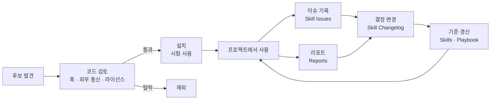

# side-toolkit

> 1인 개발자가 Claude Code로 사이드 프로젝트를 만들면서 쓰는 **플러그인과 스킬 기록**입니다.
> 어떤 플러그인을 왜 골랐는지, 작업별로 어떤 스킬을 쓰는지, 실제로 써 보니 어땠는지 정리합니다.

**English:** Notes from a solo developer on the Claude Code plugins and skills used to build side projects: what was chosen and why, which skill fits each task, and how each one held up in real work. The docs are written in Korean.

<br>

## 한눈에 보기

| 항목 | 현황 |
|---|---|
| 사용 중인 플러그인 | 19개 (claude.ai 9개, 로컬 10개) |
| 일부 저장소에서만 쓰는 플러그인 | 2개 (fluent-korean, humanize-korean). 문서 작업과 제품 저장소에서만 켭니다 |
| 사용 중지한 플러그인 | 3개 (posthog, cloudflare, stripe). 필요해지면 다시 켭니다 |
| 검토 후 제외한 플러그인 | 8개 |
| 사용 기준을 정한 작업 | 18개 |
| 변경 이력과 이슈 기록 | [Changelog](docs/Skill%20Changelog.md), [Issues](docs/Skill%20Issues.md) |

마지막으로 갱신한 날은 2026-10-27이며, 매주 갱신합니다.

<br>

## 문서

| 문서 | 이럴 때 보세요 |
|---|---|
| 📦 [**Skills**](docs/Skills.md) | 어떤 플러그인을 왜 설치했는지, 지금 상태는 어떤지, 기능이 겹치는 것은 무엇인지 궁금할 때 |
| 🧭 [**Skill Playbook**](docs/Skill%20Playbook.md) | "이 작업엔 어떤 스킬을 먼저 쓰지?" 할 때 |
| 📝 [**Skill Changelog**](docs/Skill%20Changelog.md) | 설치, 사용 중지, 우선순위 변경처럼 무엇이 언제 왜 바뀌었는지 볼 때 |
| ⚠️ [**Skill Issues**](docs/Skill%20Issues.md) | 어떤 문제가 있었고 어떻게 처리했는지 볼 때 |
| 📊 [**Reports**](reports/) | 실제 프로젝트에서 써 본 결과를 볼 때. 양식은 [_Template](reports/_Template.md)에 있습니다 |

<br>

## 영역별로 먼저 쓰는 스킬

한 작업에는 먼저 쓸 스킬을 하나만 정합니다. 자세한 기준과 근거는 [Playbook](docs/Skill%20Playbook.md)에 있습니다.

| 영역 | 먼저 쓰는 스킬 | 함께 비교하는 스킬 |
|---|---|---|
| 개발 절차 | [superpowers](https://github.com/obra/superpowers) | ponytail, caveman |
| 과설계 방지 | [ponytail](https://github.com/DietrichGebert/ponytail) (lite) | caveman `lean-build` |
| 랜딩 페이지 디자인 | [taste-skill](https://github.com/Leonxlnx/taste-skill) | frontend-design, impeccable, ui-ux-pro-max |
| 제품 UI 디자인 | [ui-ux-pro-max](https://github.com/nextlevelbuilder/ui-ux-pro-max-skill) | frontend-design |
| UI 점검과 다듬기 | [impeccable](https://github.com/pbakaus/impeccable) | — |
| 시장 전략 | gtm-planner | product-management |
| 마케팅 실행 | [marketingskills](https://github.com/coreyhaines31/marketingskills) | marketing (Anthropic) |
| 코드 리뷰 | `/code-review` | review-council |
| 한국어 문서 | [fluent-korean](https://github.com/snflkd/fluent-korean), checking-korean-writing (자체 제작) | [im-not-ai](https://github.com/epoko77-ai/im-not-ai) |
| 영어 문구 | writing-quality | marketingskills `copy-editing` |

<br>

## 자체 제작 스킬

직접 만든 스킬은 `side-skills` 플러그인으로 묶어 이 저장소에서 배포합니다.

| 스킬 | 하는 일 |
|---|---|
| [writing-concise-korean](plugins/side-skills/skills/writing-concise-korean/SKILL.md) | 한국어판 caveman입니다. 내용은 줄이되 조사와 어미는 지켜서, 짧게 써도 문장이 깨지지 않게 합니다 |
| [checking-korean-writing](plugins/side-skills/skills/checking-korean-writing/SKILL.md) | 한국어판 writing-quality입니다. 명사 나열, 명사로 끝나는 문장, 빗금, 영어 직역, 번역투를 찾아 알려 주고, 요청하면 고칩니다. 스캐너 스크립트가 들어 있습니다 |

설치는 Claude Code에서 두 줄이면 됩니다.

```
/plugin marketplace add AidenLee0408/side-toolkit
/plugin install side-skills@side-toolkit
```

<br>

## 운영 방식



**규칙**

1. **설치하기 전에 검토합니다.** 오픈소스는 설정 파일, 훅, 외부로 데이터를 보내는 코드, 라이선스를 읽고, 검토한 커밋을 기록합니다.
2. **한 서비스는 한 번만 연결합니다.** 공식 플러그인이 있으면 플러그인을, 없으면 커넥터(MCP)를 씁니다.
3. **많이 설치하지 않습니다.** 스킬이 많을수록 토큰을 더 쓰고 엉뚱한 스킬이 불립니다. 지금 단계에 필요 없는 플러그인은 사용을 중지합니다.
4. **검증되지 않은 기준은 가설로 표시합니다.** Playbook의 기준은 실제 리포트가 두 번 이상 뒷받침하기 전까지 `가설`입니다.
5. **기록은 덧붙이기만 합니다.** Changelog와 Issues는 한 줄씩 아래로 쌓고, 지난 줄의 내용은 고치지 않습니다.

<br>

## 스킬 사용 횟수 집계

Claude Code 대화 기록(`~/.claude/projects`)에서 스킬, 슬래시 명령, 서브에이전트, MCP 사용 횟수를 셉니다.

```bash
python3 scripts/skill-usage.py --root ~/SideProjects --since 2026-11-01
```

- `--root` 아래에서 실행된 세션만 셉니다. 다른 작업 기록은 섞이지 않습니다.
- 훅으로만 작동하는 플러그인(caveman, ponytail, impeccable의 훅)은 집계되지 않습니다.

<br>

## 내 환경에 가져다 쓰기

- 플러그인 목록과 검토 메모는 [Skills](docs/Skills.md)의 표를 참고하면 됩니다. 설치 명령은 각 저장소의 README를 따르세요.
- 리포트 양식([_Template](reports/_Template.md))과 집계 스크립트는 다른 프로젝트에서도 그대로 쓸 수 있습니다.
- 문서 안의 "(운영 허브 문서)" 표시는 공개하지 않은 개인 운영 문서를 가리킵니다.

<br>

## 이 저장소가 갱신되는 방식

원본은 개인 운영 허브에 있고, 주 1회 `scripts/sync-from-hub.sh`로 이 저장소에 반영합니다. 이 저장소에서 문서를 직접 고치지 않습니다.

이 저장소는 Claude Code 플러그인 마켓플레이스이기도 합니다. 직접 만든 스킬은 `plugins/side-skills/`에 추가합니다.
